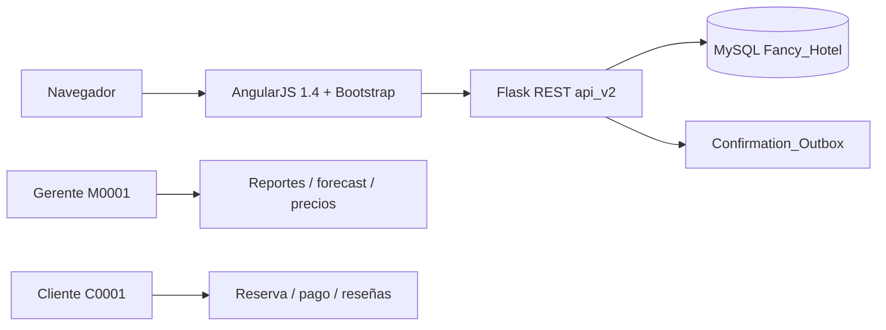

# Entrega — Proyecto 1 DSaIA

**Curso:** Tópicos Especiales II  
**Profesor:** Regis Rivera  
**Tema:** Desarrollo asistido por IA con herramientas de escritorio  
**Aplicación:** Fancy Hotel — sistema de reservas web  

---

## 1. Identificación del grupo

| Campo | Valor |
| --- | --- |
| David Bustamante — Developer | _Cédula:_ |
| Allisson Ortega — QA | _Cédula:_ |
| Fernando Delgado — Reviewer | _Cédula:_ |
| Repositorio del grupo | https://github.com/Applepie2005/proyecto1-fancy-hotel |
| Repositorio base elegido | https://github.com/thegrucoder/Hotel-Reservation-System |
| Herramienta de IA principal | **Cursor** (agente de escritorio) |
| Enunciado oficial | `fancyhotel/DSaIA-Proyecto1.pdf` |

---

## 2. Objetivo cumplido

Se modernizó y extendió un sistema de reservas hoteleras **existente** (Flask + AngularJS + MySQL), aplicando historias de usuario obligatorias y adicionales, con **proceso de ingeniería verificable**: análisis previo, decisiones humanas documentadas, pruebas automatizadas, revisión funcional y registro de uso (y mal uso) de la IA.

La evaluación no se centra en “cuánto código generó la IA”, sino en **cómo se usó, validó, corrigió y midió** — ver sección 8.

---

## 3. Repositorio elegido y análisis inicial

| Criterio | Detalle |
| --- | --- |
| Front-end | HTML5, CSS3, JavaScript (AngularJS 1.x en el fork) |
| Back-end | Python 3, Flask, Flask-RESTful |
| Base de datos | MySQL (`Fancy_Hotel`) — requisito del proyecto original |
| Motivo de elección | Alineación con el stack del curso CS 4400, repositorio real con deuda técnica útil para demostrar corrección humana (Python 2, disponibilidad incorrecta, datos sin semilla). |

**Análisis documentado antes de modificar código:** [`docs/analisis-inicial.md`](analisis-inicial.md)

**Decisiones de arquitectura:** [`docs/decisiones.md`](decisiones.md)

- Se conservaron `api.py` y `db/mysqldb.py` como referencia del código original.
- La ruta activa usa `api_v2.py`, `db/repository.py` y `serve.py` apuntando a la API modernizada.
- Contenedor Docker (`docker-compose.yml` + `Dockerfile`) para reproducir demo en clase.

---

## 4. Historias de usuario

### 4.1 Obligatorias (enunciado)

| ID | Historia (Yo, quiero, para) | Evidencia funcional | API / pantalla principal |
| --- | --- | --- | --- |
| US01 | Como **usuario recurrente**, quiero **reservar con datos guardados**, para **no rellenar pago cada vez**. | Tarjetas enmascaradas, reserva por `last4`, sin CVV en respuestas. | `GET/POST /api/payment`, `payment_v2.html` |
| US02 | Como **cliente**, quiero **calendario dinámico** de días disponibles/ocupados, para **elegir fechas sin intentos fallidos**. | Estados por día y sede (disponible / parcial / lleno). | `GET /api/availability/calendar`, `searchRoom_v2.html` |
| US03 | Como **administrador**, quiero **gráficos de previsión de demanda** histórica, para **ajustar precios e inventario**. | Tabla + gráfico Chart.js; solo rol `manager`. | `GET /api/reports/demandForecast`, `demandForecast.html` |

### 4.2 Adicionales (mínimo 2; implementadas 6)

| ID | Historia | Resumen de implementación |
| --- | --- | --- |
| US04 | Cancelar o modificar reserva | Solapamiento real de fechas, recálculo de costo, política de reembolso al cancelar. |
| US05 | Filtrar búsqueda | Filtros por tipo de habitación y precio máximo en búsqueda. |
| US06 | Rol administrador | Sesión Flask + rol; reportes y precios protegidos (403 para clientes). |
| US07 | Confirmación con código | Código `FH-XXXXXXXX` y bandeja `Confirmation_Outbox`. |
| US08 | Reseñas tras estancia | Solo clientes con estancia completada y no cancelada en la sede. |
| US09 | Precios por demanda | Reglas por sede/tipo/fechas; búsqueda aplica precio vigente. |

**Tabla completa con criterios de aceptación y ramas sugeridas:** [`docs/historias-issues.md`](historias-issues.md)

---

## 5. Restricciones del Proyecto 1 — checklist de entrega

| # | Requisito | Evidencia en este repositorio |
| --- | --- | --- |
| 1 | Repositorio Git | https://github.com/Applepie2005/proyecto1-fancy-hotel |
| 2 | Issues o historias de usuario | [`historias-issues.md`](historias-issues.md) + plantilla para GitHub [`github-issues-plantilla.md`](github-issues-plantilla.md) (pendiente: crear issues en remoto o captura) |
| 3 | Commits identificables | Historial en `main` (p. ej. `6aead48` APIs, `4b72e6a` UI, `9d417d1` log IA) |
| 4 | Uso de ramas | Ramas `feature/us-XX-*` por historia en [`historias-issues.md`](historias-issues.md); commits por capa en `main`. Detalle y narrativa: [`evidencia-restricciones.md`](evidencia-restricciones.md) §4. |
| 5 | Pull Request o revisión equivalente | [`docs/revisiones/revision-funcional.md`](revisiones/revision-funcional.md) (checklist Reviewer + QA) |
| 6 | Pruebas automatizadas | [`tests/test_api.py`](../tests/test_api.py) — login, tarjetas enmascaradas, solapamiento, forecast gerente, **403 cliente en forecast** |
| 7 | Evidencia del uso de IA | [`docs/ai-development-log.md`](ai-development-log.md) |
| 8 | Ejemplos de respuestas incorrectas de la IA | Sección “Ejemplos…” en el log de IA |
| 9 | Cambios rechazados de la IA | Sección “Cambios rechazados…” en el log de IA |
| 10 | Decisiones tomadas por humanos | [`docs/decisiones.md`](decisiones.md) |

---

## 6. Arquitectura y stack (sin migración de framework)



| Capa | Ubicación |
| --- | --- |
| Servidor | `fancyhotel/serve.py` |
| API REST | `fancyhotel/api_v2.py` |
| Datos y reglas de negocio | `fancyhotel/db/repository.py` |
| UI | `fancyhotel/templates/index.html`, `fancyhotel/static/views/*_v2.html`, `controllers_v2.js` |
| Infraestructura | `docker-compose.yml`, `Dockerfile`, `up.sh` |

### Previsión de demanda (explicable en presentación)

- Ocupación histórica mensual por sede: noches reservadas / (habitaciones × días del mes).
- Predicción: promedio del mismo mes en años anteriores; si no hay datos, media móvil de los últimos 3 meses.
- Sugerencia de precio (no automática): ≥80% → `+15%`; ≥60% → `+8%`; si no → `0%`.
- Implementación: `demand_forecast()` en `fancyhotel/db/repository.py`.

---

## 7. Ejecución y credenciales demo

```bash
chmod +x up.sh
./up.sh
```

Abrir: http://127.0.0.1:5001

| Rol | Usuario | Contraseña |
| --- | --- | --- |
| Cliente | `C0001` | `password` |
| Gerente | `M0001` | `password` |

**Pruebas** (requieren MySQL activo, p. ej. vía Docker):

```bash
python3 -m venv .venv && source .venv/bin/activate
pip install -r requirements.txt
docker compose up -d mysql
python -m pytest -q
```

Instrucciones ampliadas: [`README.md`](../README.md)

---

## 8. Uso de IA (resumen)

Registro completo: [`docs/ai-development-log.md`](ai-development-log.md)

| Actividad | Herramienta | Resultado | Decisión humana |
| --- | --- | --- | --- |
| Análisis del repo | Cursor | Detectó Python 2, bugs de disponibilidad, falta de semillas | Aceptado; documentado antes de codificar |
| Arquitectura | Cursor | Propuso capa `api_v2` + `repository` | Aceptado parcialmente; código original preservado |
| Forecast | Cursor | Sugirió modelo ML complejo | **Rechazado** — reglas explicables |
| Tarjetas guardadas | Cursor | Riesgo de exponer PAN completo | **Rechazado** — enmascarado + `last4` |
| Pruebas | Cursor | Suite pytest sobre API real | Aceptado; ampliada con test de rol 403 |

---

## 9. Guion de presentación (5–8 min)

Material detallado: [`docs/presentacion.md`](presentacion.md)

1. Contexto: repo base, objetivo DSaIA, herramienta Cursor.
2. Demo cliente: login → buscar Atlanta → calendario → filtro → reservar con tarjeta guardada → código de confirmación.
3. Demo gerente: forecast + explicar fórmula → crear regla de precio → ver precio en búsqueda → bandeja de confirmaciones.
4. Proceso: log IA, decisión rechazada (ML / PAN completo), revisión QA.
5. **Cambio en vivo preparado:** ajustar umbrales en `demand_forecast()` (p. ej. 80% → 70% o `+15%` → `+12%`).

---

## 10. Limitaciones declaradas

- Confirmación por correo: simulada con bandeja local (`Confirmation_Outbox`), sin SMTP en demo.
- Pagos simulados; no hay pasarela real.
- Pruebas dependen de MySQL; si Docker no está activo, pytest hace skip con mensaje explícito.
- La UI mejorada no es criterio de nota del enunciado original CS 4400; se mantuvo AngularJS por restricción de stack.

---

## 11. Índice de documentos del proyecto

| Documento | Propósito |
| --- | --- |
| [`README.md`](../README.md) | Guía técnica y mapa del repositorio |
| [`docs/ENTREGA-Proyecto1-DSaIA.md`](ENTREGA-Proyecto1-DSaIA.md) | **Este archivo — paquete de entrega** |
| [`docs/historias-issues.md`](historias-issues.md) | Historias e issues |
| [`docs/ai-development-log.md`](ai-development-log.md) | Evidencia IA |
| [`docs/decisiones.md`](decisiones.md) | Decisiones humanas |
| [`docs/revisiones/revision-funcional.md`](revisiones/revision-funcional.md) | Revisión tipo PR |
| [`docs/presentacion.md`](presentacion.md) | Guion de defensa |
| [`docs/prioridades-entrega.md`](prioridades-entrega.md) | Qué hacer antes de entregar (orden de prioridad) |
| [`docs/evidencia-restricciones.md`](evidencia-restricciones.md) | Matriz restricciones 1–10 + trazabilidad US → código → tests |

---

_Completar cédulas en la sección 1 si el campus las exige. Opcional: adjuntar diapositivas (Canva/PPT) como enlace en la entrega del campus._
