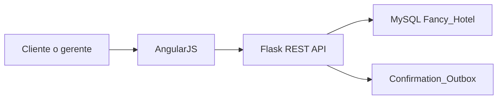

# Presentacion Proyecto 1

## 1. Contexto

Proyecto: Fancy Hotel, sistema de reservas web basado en Flask, AngularJS y MySQL.

Herramienta de IA usada: Cursor desde escritorio.

Objetivo de la demo: mostrar que la IA fue usada con analisis, validacion, correccion humana y pruebas.

## 2. Arquitectura

## 3. Demo sugerida

1. Iniciar sesion como cliente `C0001` / `password`.
2. Abrir `Make a reservation`.
3. Mostrar calendario dinamico: verde disponible, amarillo parcial, rojo lleno.
4. Buscar Atlanta con fechas futuras, aplicar filtro por tipo o precio.
5. Reservar con tarjeta guardada y mostrar codigo de confirmacion.
6. Entrar como gerente `M0001` / `password`.
7. Abrir forecast de demanda y explicar la formula.
8. Crear regla de precio y volver a buscar para ver precio ajustado.
9. Abrir bandeja de confirmaciones.

## 4. Historias implementadas

- Pago con datos guardados.
- Calendario dinamico de disponibilidad.
- Forecast de demanda.
- Cancelacion y modificacion de reservas.
- Filtros de busqueda.
- Rol administrador.
- Confirmacion con codigo.
- Resenas validadas por estancia completada.
- Precios por ocupacion confirmados por gerente.

## 5. Uso de IA

Se mostro en `docs/ai-development-log.md`:

- Analisis antes de modificar codigo.
- Propuestas aceptadas parcialmente.
- Respuestas incorrectas rechazadas.
- Decisiones tomadas por humanos.
- Pruebas automatizadas.

## 6. Cambio rapido preparado para la presentacion

Si el profesor pide un cambio en vivo, se puede modificar el umbral de sugerencia de precio en `demand_forecast()`:

- Actualmente: ocupacion >= 80 sugiere `+15%`.
- Cambio demostrable: bajar el umbral a 70 o ajustar la sugerencia a `+12%`.

## 7. Limitaciones honestas

- Docker Desktop debe estar iniciado para correr MySQL en esta maquina.
- La confirmacion por correo se demuestra como bandeja local, sin SMTP.
- Las tarjetas y pagos son simulados; no hay pasarela real.
